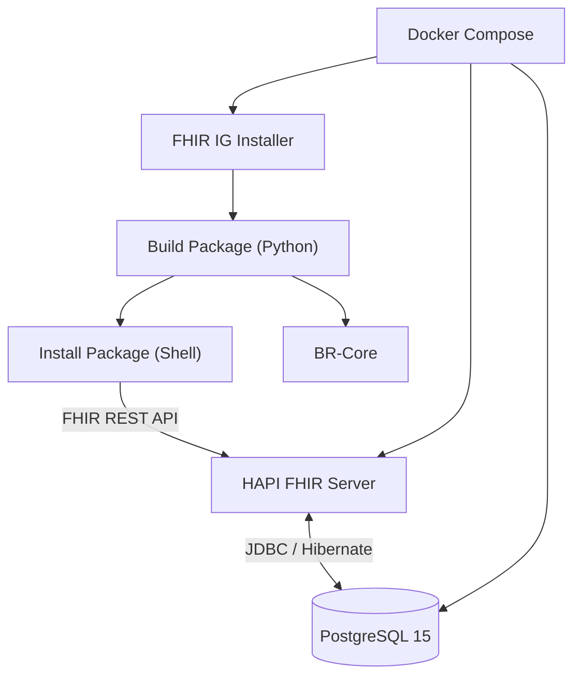

# FHIR BR Core

Ambiente local de servidor **HAPI FHIR** com suporte ao **BR-Core**, utilizando Docker Compose e PostgreSQL.

O projeto automatiza a configuração do servidor FHIR e a instalação do pacote BR-Core (FHIR R4), reduzindo a necessidade de executar manualmente as etapas de download, conversão e instalação do Implementation Guide.

## Sobre o projeto

O [HAPI FHIR](https://hapifhir.io/) é uma implementação open-source do padrão FHIR, que permite disponibilizar recursos de saúde por meio de uma API REST.

Entretanto, para trabalhar com os perfis brasileiros definidos pelo BR-Core, é necessário disponibilizar esses artefatos no servidor.

Este projeto utiliza o HAPI FHIR JPA Server como base e automatiza a instalação do pacote BR-Core, permitindo que o ambiente seja inicializado com poucos comandos.

## Tecnologias utilizadas

- **HAPI FHIR:** servidor responsável pela implementação da API FHIR.
- **FHIR R4:** versão do padrão FHIR utilizada pelo BR-Core.
- **PostgreSQL 15:** banco de dados utilizado pelo HAPI FHIR.
- **Docker:** execução dos serviços em containers.
- **Docker Compose:** gerenciamento e integração dos serviços.
- **Python 3.12:** download, extração e conversão do pacote BR-Core.
- **Shell Script:** automação da configuração e instalação inicial.

## Estrutura do projeto

```text
fhir-br-core/
├── scripts/
│   ├── build-package.py
│   └── install-package.sh
│
├── fhir-packages/
│   └── .gitkeep
│
├── application.yaml
├── docker-compose.yml
├── .env.example
├── .gitignore
└── README.md
```

### Responsabilidade dos arquivos

| Arquivo | Responsabilidade |
|---|---|
| `docker-compose.yml` | Define e inicializa os serviços. |
| `application.yaml` | Configura o HAPI FHIR e sua conexão com o PostgreSQL. |
| `.env.example` | Modelo das variáveis de ambiente necessárias. |
| `scripts/build-package.py` | Obtém e converte o pacote BR-Core para o formato esperado pela operação de instalação. |
| `scripts/install-package.sh` | Executa a instalação inicial do BR-Core no HAPI FHIR. |
| `fhir-packages/` | Armazena o pacote convertido para instalação. |

## Arquitetura

O ambiente é composto por três serviços principais:



### Serviços

| Serviço | Container | Descrição |
|---|---|---|
| `fhir-server` | `fhir-br-core-api` | Servidor HAPI FHIR. |
| `fhir-db` | `fhir-br-core-db` | Banco PostgreSQL. |
| `fhir-ig-installer` | `fhir-br-core-installer` | Executa a geração e instalação inicial do pacote BR-Core. |

## Requisitos

Antes de iniciar, é necessário ter instalado:

- [Docker Engine](https://docs.docker.com/engine/install/)
- [Docker Compose](https://docs.docker.com/compose/install/) (plugin `docker compose`)
- Git

O Python 3.12 e o cURL são disponibilizados no próprio container instalador, não sendo necessário instalá-los manualmente na máquina host.

## Configuração

### 1. Clonar o repositório

```bash
git clone https://github.com/alisson1228/fhir-br-core.git
cd fhir-br-core
```

### 2. Configurar as variáveis de ambiente

Crie o arquivo `.env` a partir do modelo disponibilizado:

```bash
cp .env.example .env
```

Edite o arquivo:

```bash
nano .env
```

Configure a senha do PostgreSQL:

```env
POSTGRES_PASSWORD=sua_senha_forte
```

**Importante:** o arquivo `.env` contém informações sensíveis e não deve ser versionado no Git.

### 3. Iniciar o ambiente

Execute:

```bash
docker compose up -d
```

O Docker Compose iniciará os serviços definidos no projeto.

## Instalação automatizada do BR-Core

A instalação do pacote é executada automaticamente pelo serviço `fhir-ig-installer`.

O processo ocorre na seguinte ordem:

1. **Verificação da instalação:** verifica se o pacote já foi instalado anteriormente.
2. **Geração do pacote:** executa `scripts/build-package.py`.
3. **Download:** obtém o arquivo ZIP disponibilizado pelo BR-Core.
4. **Extração:** localiza o arquivo `site/package.r4.tgz` dentro do ZIP.
5. **Conversão:** transforma o conteúdo TGZ em Base64 e gera um recurso FHIR `Parameters` no formato JSON.
6. **Disponibilidade do servidor:** aguarda o HAPI FHIR responder ao endpoint `/fhir/metadata`.
7. **Instalação:** envia o pacote ao endpoint `$install` do HAPI FHIR.
8. **Registro:** após a instalação bem-sucedida, cria um marcador persistente para evitar a repetição do processo.

A requisição utilizada para instalar o pacote é equivalente a:

```bash
curl -fS -X POST \
  -H "Content-Type: application/fhir+json" \
  -H "Accept: application/fhir+json" \
  --data-binary @fhir-packages/package.r4.json \
  'http://localhost:8080/fhir/ImplementationGuide/$install'
```

### Controle da primeira instalação

O serviço utiliza um volume Docker persistente chamado `fhir-br-core-setup-data` para armazenar o estado da instalação.

Depois de concluir o processo, é criado o arquivo:

```text
/setup-state/installed
```

Nas próximas inicializações, o instalador verifica esse arquivo e encerra sem repetir a instalação.

Isso permite recriar os containers sem precisar instalar o BR-Core novamente, desde que o volume de controle seja preservado.

## Acessando o servidor

Após a inicialização, o HAPI FHIR estará disponível localmente.

| Recurso | Endereço |
|---|---|
| Servidor HAPI FHIR | http://localhost:8080 |
| API FHIR | http://localhost:8080/fhir |
| CapabilityStatement | http://localhost:8080/fhir/metadata |
| Swagger UI | http://localhost:8080/fhir/swagger-ui |

### Verificando a instalação

É possível consultar um perfil do BR-Core utilizando sua URL canônica.

Exemplo: consulta ao perfil brasileiro de paciente.

```bash
curl -s \
  -H "Accept: application/fhir+json" \
  "http://localhost:8080/fhir/StructureDefinition?url=https://br-core.saude.gov.br/fhir/StructureDefinition/br-core-patient"
```

A resposta deve apresentar os recursos `StructureDefinition` encontrados pelo servidor.

## Comandos úteis

### Inicializar os serviços

```bash
docker compose up -d
```

### Acompanhar os logs

```bash
docker compose logs -f
```

### Acompanhar somente a instalação

```bash
docker compose logs -f fhir-ig-installer
```

### Verificar os containers

```bash
docker compose ps
```

### Parar os serviços

```bash
docker compose down
```

### Reiniciar os serviços

```bash
docker compose restart
```

**Atenção:** evite executar `docker compose down -v` sem necessidade. Esse comando remove os volumes do projeto, incluindo os dados do PostgreSQL e o marcador que controla a instalação inicial.

## Referências

- [Configurando um Servidor HAPI FHIR com BR-Core — DEV Community](https://dev.to/debugdavi/configurando-um-servidor-hapi-fhir-com-br-core-2o7g)
- [Documentação oficial do HAPI FHIR](https://hapifhir.io/)
- [Repositório HAPI FHIR](https://github.com/hapifhir/hapi-fhir)
- [BR-Core — HL7 Brasil](https://hl7.org.br/fhir/core/)
- [Downloads do BR-Core](https://hl7.org.br/fhir/core/downloads.html)

## Observações

Este projeto tem como objetivo disponibilizar um ambiente de desenvolvimento local para trabalhar com o HAPI FHIR e os perfis do BR-Core.

As configurações atuais são voltadas para desenvolvimento e testes. Antes de utilizar o ambiente em produção, é necessário revisar aspectos como segurança, autenticação, CORS, exposição de portas, persistência, backups e gerenciamento de credenciais.
